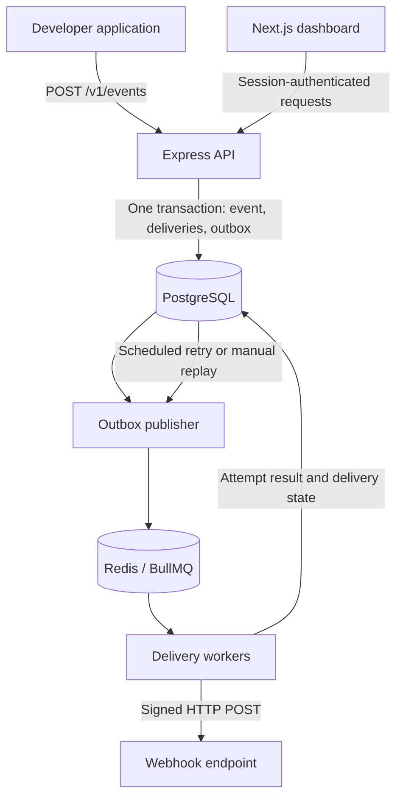

# HookRelay

A self-hosted webhook delivery platform built with TypeScript, Next.js, Express, PostgreSQL, Redis, BullMQ, and Drizzle. Events and delivery history live in PostgreSQL; Redis handles execution. Includes a working dashboard, API, worker, transactional outbox publisher, Node SDK, tests, and Docker Compose deployment.

## Features

- **Projects and API keys:** account registration, project isolation, one-time key creation, hashed key storage, and revocation.
- **Endpoint management:** public URL validation, event subscriptions, enable/disable controls, and test events.
- **Durable ingestion:** JSON payload validation, project-scoped idempotency, and transactional event fan-out.
- **Asynchronous delivery:** BullMQ workers, configurable concurrency, timeouts, and automatic retries with jitter.
- **Webhook security:** HMAC-SHA256 signatures, timestamp verification, encrypted signing secrets, and SSRF protection.
- **Delivery visibility:** event search, attempt history, response status codes, latency, and delivery analytics.
- **Recovery:** a dead letter queue and manual replay with preserved attempt and replay history.
- **Self-hosting:** Docker Compose, SQL migrations, Prometheus metrics, and Grafana datasource provisioning.

## Contents

- [Quick start](#quick-start)
- [Local development](#local-development)
- [Architecture](#architecture)
- [Send an event](#send-an-event)
- [Receive and verify webhooks](#receive-and-verify-webhooks)
- [Reliability model](#reliability-model)
- [Dashboard and management API](#dashboard-and-management-api)
- [Configuration](#configuration)
- [Tests and checks](#tests-and-checks)
- [Monitoring](#monitoring)
- [Troubleshooting](#troubleshooting)
- [Before an internet-facing deployment](#before-an-internet-facing-deployment)
- [Repository](#repository)

## Quick start

Run these commands from the repository root. The Docker setup requires Node.js 22+ to generate the environment file, plus a running Docker Engine with Compose. Local development also requires pnpm 10.32.1. If pnpm is unavailable, use `npm exec --yes pnpm@10.32.1 -- <command>` in its place.

```sh
node scripts/setup.mjs
docker compose up --build -d
```

Open **[HookRelay](http://localhost:3000)** and complete your first integration:

1. Create an account and a project.
2. Add a public webhook endpoint and select its event subscriptions (`*` subscribes to all event types).
3. Save the signing secret shown after endpoint creation.
4. Create an API key for your application, or use **Send event** in the dashboard.
5. Open **Events** to inspect the payload and delivery attempts. Exhausted deliveries appear in **Dead letter queue** and can be replayed.

Endpoint test buttons send real signed `hookrelay.test` events to the chosen endpoint.

`setup.mjs` creates `.env` with a cryptographically random encryption key and preserves any existing `.env`. Back up this key alongside the database: existing endpoint secrets cannot be recovered without it. Local `.env` is ignored by Git and excluded from Docker images.

Compose runs PostgreSQL, Redis, migrations, API, publisher, worker, and web. Data is stored in named volumes. Local ports bind to `127.0.0.1`. Default database credentials are for this local deployment. Use `docker compose stop` to stop services without deleting data.

## Local development

```sh
pnpm install
pnpm run setup
docker compose up -d postgres redis
pnpm db:migrate
pnpm dev
```

- Dashboard: http://localhost:3000
- API: http://localhost:4000
- Health: http://localhost:4000/health (PostgreSQL connectivity)
- API metrics: http://localhost:9091/metrics when running locally
- Worker metrics: http://localhost:9092/metrics when running locally

Development PostgreSQL and Redis bind to ports **55432** and **56379** respectively, avoiding common local-service conflicts. Containers use their standard internal ports. The values in `.env.example` match these mappings.

The dashboard proxies `/api/*` to Express, keeping cookies same-origin. Docker builds set `API_URL=http://api:4000`; the local default is `http://localhost:4000`. `API_URL` is read at Next.js build/start configuration time. The source of truth for schema changes is the versioned SQL in `apps/server/migrations`, applied under an advisory lock by `pnpm db:migrate`. Queries and transactions use Drizzle's parameterized SQL API.

### Useful commands

| Command | What it does |
| --- | --- |
| `pnpm run setup` | Create `.env` and a random encryption key if the file does not exist |
| `pnpm dev` | Start the dashboard, API, publisher, and worker together |
| `pnpm db:migrate` | Apply pending SQL migrations |
| `pnpm typecheck` | Check TypeScript across the workspace |
| `pnpm test` | Run unit tests; integration tests require `RUN_INTEGRATION=1` |
| `pnpm build` | Compile the server/SDK and build the dashboard |
| `docker compose ps` | Inspect container status |
| `docker compose logs -f api publisher worker` | Follow delivery-service logs |
| `docker compose stop` | Stop containers while preserving data |

Use `pnpm run setup`, including `run`, to invoke this repository's script rather than pnpm's built-in setup command. Stop a running `pnpm dev` session before starting the full Docker stack, since both use ports 3000 and 4000.

## Architecture



PostgreSQL is the source of truth. Queue publication runs separately from ingestion, so accepted events survive queue outages. The API, publisher, and worker are separate processes; the dashboard communicates with the API through a same-origin proxy.

| Layer | Technology |
| --- | --- |
| Dashboard | Next.js, React, TypeScript, Tailwind CSS, Radix UI, TanStack Query |
| API | Node.js, Express, Zod, Pino |
| Persistence | PostgreSQL, Drizzle parameterized SQL, versioned SQL migrations |
| Background jobs | Redis, BullMQ |
| Verification | Vitest, Supertest, k6 load scenario |
| Deployment and monitoring | Docker Compose, Prometheus, Grafana |

## Send an event

From Bash or another POSIX-compatible shell:

```sh
curl http://localhost:4000/v1/events \
  -H 'Authorization: Bearer YOUR_API_KEY' \
  -H 'Content-Type: application/json' \
  -H 'Idempotency-Key: order-123' \
  -d '{"type":"order.created","data":{"order_id":"123","amount":4900}}'
```

From PowerShell, set `HOOKRELAY_API_KEY` in your environment, then run:

```powershell
$headers = @{
  Authorization = "Bearer $env:HOOKRELAY_API_KEY"
  'Idempotency-Key' = 'order-123'
}
$body = @{
  type = 'order.created'
  data = @{ order_id = '123'; amount = 4900 }
} | ConvertTo-Json -Depth 10

Invoke-RestMethod -Uri 'http://localhost:4000/v1/events' `
  -Method Post -Headers $headers -ContentType 'application/json' -Body $body
```

New events return HTTP `202` with `{ "id": "...", "duplicate": false }` after durable persistence, without waiting for delivery. Idempotent duplicates return `200` and the original ID. Conflicting payloads under the same key return `409`. Keys are scoped to projects. Idempotency keys are limited to 200 characters; payloads to 256 KB. `data` must be a JSON object. Event types allow letters, numbers, dots, underscores, and hyphens, up to 100 characters.

The workspace SDK is available as `@hookrelay/sdk` to TypeScript consumers in this repository:

```ts
import { HookRelay } from "@hookrelay/sdk";
const relay = new HookRelay({
  baseUrl: "http://localhost:4000",
  apiKey: process.env.HOOKRELAY_KEY!,
});
await relay.send("order.created", { order_id: "123" }, "order-123");
```

## Receive and verify webhooks

Outgoing JSON has this shape:

```json
{
  "id": "event-uuid",
  "type": "order.created",
  "data": { "order_id": "123" },
  "created_at": "2026-11-08T10:00:00.000Z"
}
```

Headers: `webhook-id`, `webhook-timestamp` (Unix seconds), and `webhook-signature` (`v1=` plus a SHA-256 HMAC hex digest). The signed string is `${eventId}.${timestamp}.${rawBody}`. Keep the original body bytes; reserializing parsed JSON can invalidate the signature.

```ts
import express from "express";
import { verifyWebhook } from "@hookrelay/sdk";
const app = express();
app.post("/webhooks", express.raw({ type: "application/json" }), (req, res) => {
  const valid = verifyWebhook(
    process.env.WEBHOOK_SECRET!,
    req.get("webhook-id") || "",
    req.get("webhook-timestamp") || "",
    req.get("webhook-signature") || "",
    req.body.toString("utf8"),
  );
  if (!valid) return res.sendStatus(401);
  // Atomically deduplicate event IDs in your own DB, persist the work, then acknowledge.
  return res.sendStatus(204);
});
```

Verification rejects timestamps more than five minutes in the past or future. Timestamp checks limit replay exposure; receivers still need durable event-ID deduplication, including manual replays. Delivery is **at least once**, with no ordering guarantee. If a process dies after the receiver accepts a request but before PostgreSQL records success, the request can be delivered again.

## Reliability model

1. An ingestion transaction inserts an event, matching delivery rows, and outbox rows together. A database uniqueness constraint handles concurrent idempotency keys. Each enabled subscribed endpoint gets one delivery. No subscribers is a valid accepted event.
2. The publisher locks pending outbox rows with `FOR UPDATE SKIP LOCKED`, publishes deterministic BullMQ job IDs, and marks publication. A crash between publication and commit can republish safely.
3. A worker conditionally claims the matching delivery generation/attempt using a database lease and fencing token. Stale replay generations and duplicate jobs cannot record a second result.
4. It resolves and validates the destination again, pins the validated address for the HTTP connection, signs the body, and sends with a timeout. Redirects are not followed. Receiver response bodies are neither persisted nor logged.
5. A result transaction records the attempt and either success, the next scheduled outbox entry, or terminal failure. HTTP 408, 429, 5xx, network failures and timeouts retry. Other non-2xx responses fail immediately. Disabled/deleted endpoints fail without sending; already in-flight requests may finish.
6. Retries use exponential backoff with jitter. `Retry-After` on 429/503 is honored up to 24 hours. Default maximum is 8 attempts per cycle. Failed deliveries form the DLQ.
7. Replay increments a generation and creates a fresh outbox entry. Original attempts and the actor/time of every replay remain in PostgreSQL.
8. The publisher reconciles uncompleted deliveries after 60 seconds, allowing recovery after Redis job loss or exhausted infrastructure retries. A lost Redis database does not erase events or delivery history.

## Dashboard and management API

Create an account and authenticate through the browser. Management routes use a 7-day HTTP-only SameSite=Strict session. Mutation requests must include the configured `APP_ORIGIN` as their Origin header. Machine ingestion uses Bearer API keys and does not use browser sessions.

| Method     | Route                                            | Purpose                                       |
| ---------- | ------------------------------------------------ | --------------------------------------------- |
| POST       | `/auth/register`, `/auth/login`, `/auth/logout`  | Account/session lifecycle                     |
| GET        | `/auth/me`                                       | Current account                               |
| GET / POST | `/projects`                                      | List/create owned projects                    |
| GET / POST | `/projects/:project/keys`                        | List metadata/create one-time API key         |
| DELETE     | `/projects/:project/keys/:key`                   | Revoke key                                    |
| GET / POST | `/projects/:project/endpoints`                   | List/create endpoints and subscriptions       |
| PATCH      | `/projects/:project/endpoints/:endpoint`         | Set `{ "enabled": true/false }`               |
| DELETE     | `/projects/:project/endpoints/:endpoint`         | Soft-delete endpoint                          |
| POST       | `/projects/:project/endpoints/:endpoint/test`    | Send a targeted test                          |
| GET / POST | `/projects/:project/events`                      | List/send events                              |
| GET        | `/projects/:project/events/:event`               | Payload, deliveries, attempts, replay history |
| GET        | `/projects/:project/dlq`                         | Failed deliveries                             |
| POST       | `/projects/:project/deliveries/:delivery/replay` | Replay a failed delivery                      |
| GET        | `/projects/:project/stats`                       | Totals and 24-hour attempt timeline           |
| POST       | `/v1/events`                                     | Bearer-key authenticated event ingestion      |

Event lists accept `q` and `offset`; DLQ accepts `offset`. Page size is 25. Rotate an API key by creating a replacement, updating your application, and revoking the old one. To change an endpoint URL or subscriptions, create a replacement endpoint and disable/delete the old one; in-place editing and signing-secret rotation are not included in this version.

## Configuration

| Variable              | Default                 | Purpose                                        |
| --------------------- | ----------------------- | ---------------------------------------------- |
| `DATABASE_URL`        | Required                | PostgreSQL connection                          |
| `REDIS_URL`           | Required                | Redis connection, supports `rediss:`           |
| `ENCRYPTION_KEY`      | Required                | 32 bytes encoded as 64 hex characters          |
| `APP_ORIGIN`          | `http://localhost:3000` | Exact browser origin                           |
| `API_URL`             | `http://localhost:4000` | Dashboard proxy target                         |
| `PORT`                | `4000`                  | API listener                                   |
| `WORKER_CONCURRENCY`  | `10`                    | Concurrent jobs per worker, maximum 100        |
| `DELIVERY_TIMEOUT_MS` | `10000`                 | HTTP timeout, maximum 30000                    |
| `MAX_ATTEMPTS`        | `8`                     | Attempts per delivery/replay cycle, maximum 20 |
| `NODE_ENV`            | `development`           | `production` enables Secure session cookies    |

All endpoint IPs must be public. Loopback, private, link-local, multicast, reserved ranges, mapped private IPv6, credentials, fragments, and ports other than 80/443 are rejected. For local receiver testing, use a public HTTPS tunnel; private endpoints are deliberately not enabled through a bypass flag.

## Tests and checks

```sh
pnpm typecheck
pnpm test
pnpm build
```

Database integration tests create a unique temporary schema and drop only that schema afterward. They cover tenant isolation, concurrent idempotency, transactional outbox creation, real signature verification, retry scheduling, retry exhaustion, DLQ, replay history, disabled endpoints, lease recovery, and revoked credentials. A real Redis/BullMQ test verifies publishing and recovery after a queue job is lost, using a dedicated temporary queue. HTTP receivers are injected for deterministic failure scenarios. Start PostgreSQL and Redis, then:

```powershell
$env:RUN_INTEGRATION = '1'
pnpm test
```

```sh
RUN_INTEGRATION=1 pnpm test
```

Load testing with k6 (use a dedicated test project; this creates real events):

```sh
k6 run -e API_KEY=YOUR_TEST_KEY scripts/load.js
```

## Monitoring

```sh
docker compose --profile monitoring up -d
```

Prometheus: http://localhost:9090. Grafana: http://localhost:3001 (admin / `GRAFANA_PASSWORD`, set your own). Prometheus datasource is provisioned automatically. Query `hookrelay_http_requests_total` and `hookrelay_delivery_attempts_total`, plus Node runtime metrics. The dashboard analytics are durable PostgreSQL-derived metrics; Prometheus counters are per-process and reset on restart. Metrics listeners are not published by Compose. No Grafana dashboard is prebuilt.

## Troubleshooting

| Symptom | What to check |
| --- | --- |
| Docker cannot connect to its engine | Start Docker Desktop or Docker Engine, then retry `docker compose ps`. |
| A port is already in use | Stop the other HookRelay launch mode, or update the host mapping and corresponding local connection URL. Default database/Redis host ports are 55432/56379. |
| Dashboard reports the API is unavailable | Check the API process, `API_URL`, and [API health](http://localhost:4000/health). In Docker, inspect `docker compose logs api migrate`. |
| Startup reports an invalid encryption key | Run `node scripts/setup.mjs` for a new checkout. If `.env` already exists, restore its valid 64-character hex key; the setup script preserves existing files. |
| A dashboard mutation returns HTTP 403 | Open the dashboard at the exact `APP_ORIGIN`. `localhost` and `127.0.0.1` are different origins. Restart the API after changing its configuration. |
| Endpoint registration rejects a URL | Use a public HTTP(S) destination on port 80 or 443. Private IPs and local URLs are blocked. |
| An event has no deliveries | Verify that an enabled endpoint subscribed to the event type existed when the event was ingested. Adding an endpoint does not backfill earlier events. |
| Deliveries remain pending | Check publisher and worker logs, Redis connectivity, and the scheduled retry time. A `Retry-After` header can delay the next attempt. |
| Signature verification fails | Verify the exact raw body, event ID, timestamp, and endpoint signing secret. Check that the receiver's clock is synchronized. |
| Integration tests are skipped | Start PostgreSQL and Redis and set `RUN_INTEGRATION=1` before running `pnpm test`. |

## Before an internet-facing deployment

This is an initial implementation, not a claim of production readiness. Put the web application behind HTTPS, set `NODE_ENV=production` and the exact `APP_ORIGIN`, change deployment credentials, restrict database/Redis/metrics access, and back up PostgreSQL plus the encryption key. Rate limiting is in-process (600 requests/minute/IP; authentication 30/15 minutes), so multi-replica deployments need a shared gateway limiter and project quotas. Never blindly trust forwarded IP headers.

Open registration is currently enabled. Invite-only access, password reset/email verification, team RBAC, event retention/partitioning, encryption-key rotation, distributed quotas, and a published SDK package are future work. Large fan-outs currently insert delivery rows within the ingestion transaction; benchmark your actual workload before choosing a capacity target. Enforce a network egress policy as defense in depth around the application-level SSRF checks. API access logs intentionally exclude credentials and payloads.

## Repository

```text
apps/web/           Next.js dashboard, TanStack Query, Tailwind, Radix UI primitives
apps/server/src/    Express API, publisher, BullMQ worker, security and delivery logic
apps/server/test/   Unit and PostgreSQL integration tests
apps/server/migrations/  Versioned transactional SQL migrations
packages/sdk/      Event ingestion client and signature verification helpers
infra/             Prometheus and Grafana datasource provisioning
scripts/           Environment setup and k6 load scenario
compose.yaml       Local self-hosted deployment
```
